# Phase 8: Chat Agent Orchestration & User-Attributed Tool Loop

## 1. Architecture Overview

The Urumi MCP Gateway chat agent allows authenticated team members to execute natural language tasks that coordinate multiple internal cluster tools (WooCommerce, Inventory, Shipping).

Unlike typical naive agent implementations, **the chat agent never connects directly to upstream MCP servers**. It operates strictly through the Gateway's central authorization, routing, and audit layer.

```mermaid
sequenceDiagram
    autonumber
    actor User as Authenticated User
    participant Dash as Dashboard UI
    participant Gateway as Central Gateway API (/api/chat)
    participant Orchestrator as ChatOrchestrator
    participant LLM as LLM Provider (OpenAI / Mock)
    participant UpstreamMgr as UpstreamManager & Auth
    participant Upstreams as Internal Upstreams (Woo / Inv / Ship)
    participant Audit as AuditRepository (Postgres/SQLite)

    User->>Dash: "Check stock for SKU-HOODIE-M and estimate shipping to CA"
    Dash->>Gateway: POST /api/chat { message, history } (Bearer JWT)
    Note over Gateway: Authenticates session, extracts req.user
    Gateway->>Orchestrator: runChatTurn(user, message, history)
    Orchestrator->>UpstreamMgr: getAggregatedTools()
    UpstreamMgr-->>Orchestrator: Sanitized Tool Definitions
    
    rect rgb(20, 25, 45)
        Note over Orchestrator,LLM: Step 1: Inventory Tool Execution
        Orchestrator->>LLM: chatCompletion(messages, tools)
        LLM-->>Orchestrator: tool_calls: [inventory__get_stock({ sku: 'SKU-HOODIE-M' })]
        Orchestrator->>UpstreamMgr: executeTool(user, 'inventory__get_stock', args)
        UpstreamMgr->>Upstreams: HTTP JSON-RPC callTool
        Upstreams-->>UpstreamMgr: { availableQuantity: 42, location: 'Bay-7' }
        UpstreamMgr->>Audit: createAuditLog(userId, tool, duration, status)
        UpstreamMgr-->>Orchestrator: Tool Result
    end

    rect rgb(20, 25, 45)
        Note over Orchestrator,LLM: Step 2: Shipping Tool Execution
        Orchestrator->>LLM: chatCompletion(messages + toolResult1, tools)
        LLM-->>Orchestrator: tool_calls: [shipping__estimate_shipping({ ... })]
        Orchestrator->>UpstreamMgr: executeTool(user, 'shipping__estimate_shipping', args)
        UpstreamMgr->>Upstreams: HTTP JSON-RPC callTool
        Upstreams-->>UpstreamMgr: { estimated_cost_usd: '16.50', service_level: 'Priority' }
        UpstreamMgr->>Audit: createAuditLog(userId, tool, duration, status)
        UpstreamMgr-->>Orchestrator: Tool Result
    end

    Orchestrator->>LLM: chatCompletion(messages + toolResult2, tools)
    LLM-->>Orchestrator: Final Synthesized Reply
    Orchestrator-->>Gateway: ChatTurnResult (Reply + Detailed Tool Traces)
    Gateway-->>Dash: HTTP 200 { reply, toolCalls, isDemoMode, ... }
    Dash-->>User: Render assistant message & structured tool execution trace
```



---

## 2. Security & Identity Safeguards

1. **Server-Side Identity Binding**:
   - The user identity is extracted strictly from the verified JWT bearer token on the server (`req.user`).
   - Any client payload attempts to specify or spoof `{ user: { id, role } }` are completely ignored.
2. **Untrusted Tool Boundaries**:
   - System prompts explicitly instruct the LLM that tool descriptions, inputs, and outputs are untrusted external data.
   - Tool outputs cannot override system instructions or modify user privileges.
   - Gateway enforces authorization checks in native backend code regardless of model requests.
3. **Provider Secret Isolation**:
   - External LLM provider API keys (`LLM_API_KEY`, `OPENAI_API_KEY`) reside exclusively in server environment variables or Kubernetes Secrets.
   - Provider keys are never compiled into client frontend bundles or output in server logs.
4. **Bounded Execution Loop**:
   - The tool calling loop is bounded by `LLM_MAX_STEPS` (default: `5`).
   - Prevents runaway recursion, excessive billing, or infinite loops if the model repeatedly calls tools.
5. **Safe Audit Logging**:
   - Every tool call initiated by the model is logged in the audit database with the authenticated user's ID and email.
   - Sensitive credentials and tokens are redacted before storing parameters in the audit database.

---

## 3. Configuration & Providers

Configure the chat agent in `.env` or Kubernetes Helm values:

```bash
# 1. Deterministic Zero-Cost Mock Mode (Default for test/demo)
LLM_PROVIDER=mock
LLM_MAX_STEPS=5

# 2. OpenAI Provider
LLM_PROVIDER=openai
LLM_API_KEY=sk-proj-...
LLM_MODEL=gpt-4o-mini
LLM_MAX_STEPS=5

# 3. Local Ollama Provider (OpenAI-compatible)
LLM_PROVIDER=ollama
LLM_MODEL=llama3.2
LLM_BASE_URL=http://localhost:11434/v1
LLM_MAX_STEPS=5
```

---

## 4. Acceptance Test Scenarios

### Test 1: Product Creation
- **Prompt**: `"Create a product named 'Vintage Leather Jacket' with price 89.99"`
- **Expected Outcome**:
  - The model invokes `woocommerce__create_product` with `{ name: 'Vintage Leather Jacket', regular_price: '89.99' }`.
  - The product is published in the WooCommerce catalog.
  - The audit log records the tool call attributed to the current user.

### Test 2: Order Inquiry
- **Prompt**: `"What orders came in today?"`
- **Expected Outcome**:
  - The model invokes `woocommerce__list_orders` with `{ created_today: true }`.
  - The model returns a formatted summary of matching store orders.
  - The audit log records the tool call attributed to the current user.

### Test 3: Multi-Upstream Coordination
- **Prompt**: `"Check stock for SKU-HOODIE-M and estimate shipping to CA"`
- **Expected Outcome**:
  - Step 1 calls `inventory__get_stock` (`inventory` upstream).
  - Step 2 calls `shipping__estimate_shipping` (`shipping` upstream).
  - Assistant synthesizes a combined stock and shipping rate response.
  - The UI tool trace explicitly displays calls to **two distinct upstream services**.
